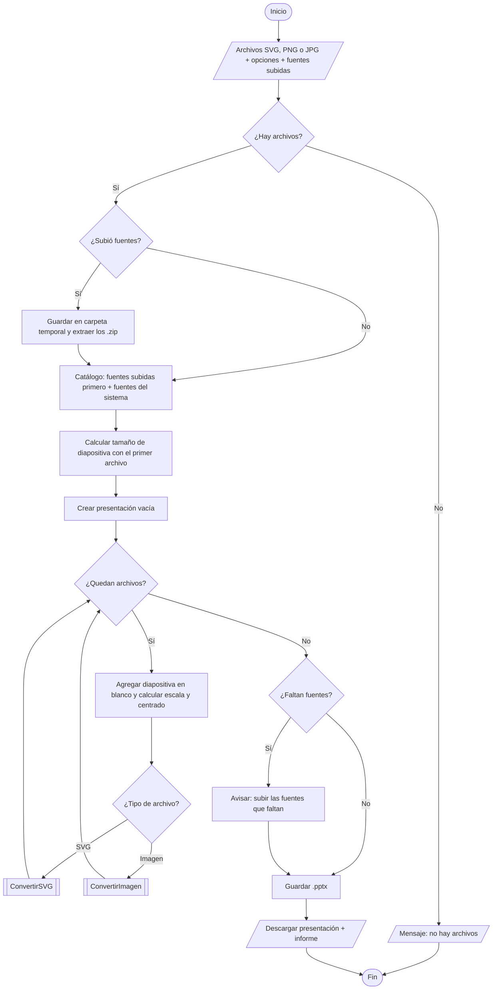
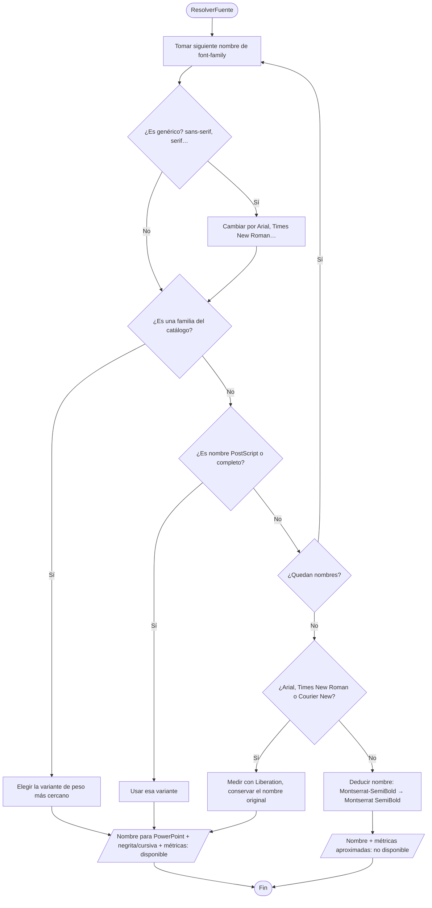
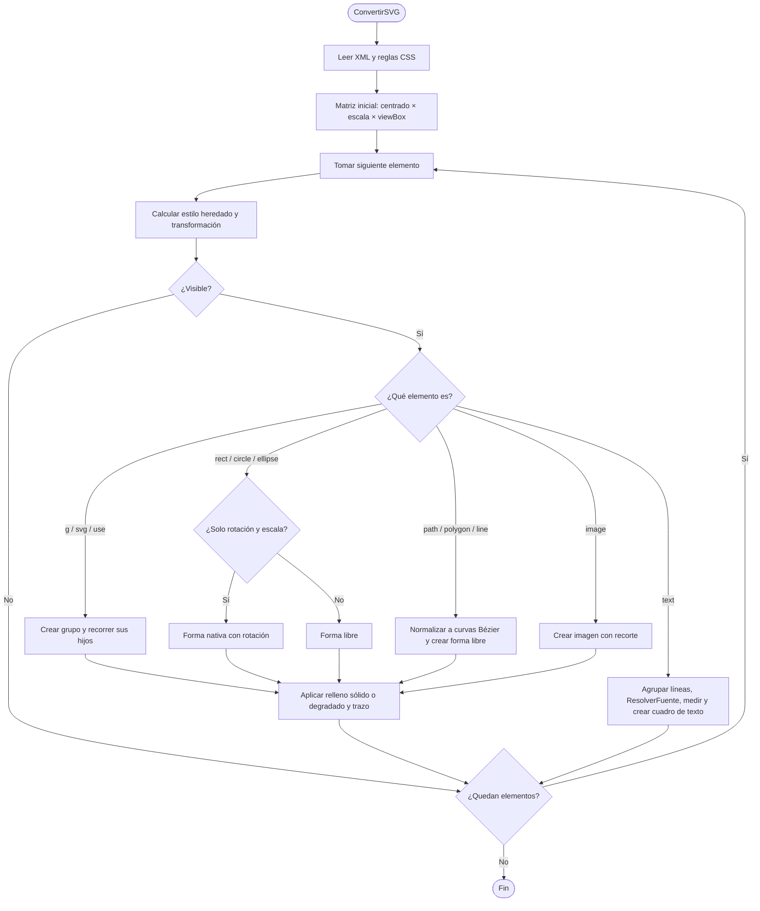
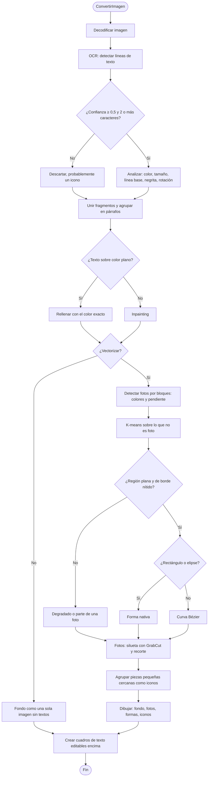

# Diseño → PowerPoint editable

Convierte diseños **SVG** o **imágenes (PNG/JPG/WEBP)** en presentaciones `.pptx` cuyos
elementos son **nativos y editables** en PowerPoint: cuadros de texto reales con la tipografía
original, formas con sus colores, degradados y trazos, imágenes y grupos con el nombre de la capa.

## Instalación

```bash
pip install -r requirements.txt
```

## Uso

**App web (arrastrar y soltar):**
```bash
streamlit run app.py
```
Se abre en el navegador. Subes uno o varios archivos (cada uno será una diapositiva), eliges
opciones y descargas el `.pptx`.

**Terminal:**
```bash
python convertir.py portada.svg interior-*.svg -o propuesta.pptx
python convertir.py flyer.png -o flyer.pptx --fuente "Montserrat" --fuente-titulos "Montserrat Black"
python convertir.py flyer.png -o flyer.pptx --vectorizar
```

**Desde Python:**
```python
from diseno_a_pptx import convertir_archivos
pptx, informe = convertir_archivos([("portada.svg", open("portada.svg", "rb").read())])
open("portada.pptx", "wb").write(pptx)
print(informe.fuentes, informe.avisos)
```

## Despliegue en Streamlit Community Cloud

El proyecto ya incluye todo lo necesario:

| Archivo | Para qué sirve |
|---|---|
| `requirements.txt` | Librerías de Python (con OpenCV *headless*, la versión para servidores) |
| `packages.txt` | Paquetes del sistema Linux: fuentes Liberation (equivalentes métricos de Arial, Times New Roman y Courier New) y DejaVu |
| `.streamlit/config.toml` | Límite de subida (100 MB por archivo) y dos temas: **claro** (crema y coral) y **nocturno** (azul noche y coral). La app sigue el modo del sistema y se puede cambiar en ⋮ › Settings › Theme |
| `.gitignore` | Excluye cachés de Python, entornos virtuales y `secrets.toml` |

**Pasos:**
1. Sube la carpeta del proyecto a un repositorio de GitHub (público o privado).
   `app.py`, `requirements.txt` y `packages.txt` deben quedar en la **raíz** del repositorio.
2. Entra en [share.streamlit.io](https://share.streamlit.io) con tu cuenta de GitHub › **Create app**.
3. Elige el repositorio y la rama, y en *Main file path* escribe `app.py`.
4. En **Advanced settings** elige **Python 3.12** (también funciona 3.11).
5. **Deploy**. La primera instalación tarda unos minutos.

**A tener en cuenta en la nube:**
- **Tipografías:** el servidor no tiene tus fuentes. Súbelas desde la barra lateral
  (*Tus tipografías*), sueltas o en un `.zip`, para que los textos queden en su posición exacta.
  Se usan solo durante la sesión y no se guardan. Si no las subes, el PowerPoint se genera igual
  con el nombre correcto de la fuente, pero la posición de los textos es aproximada.
- **OCR:** la primera conversión de una imagen descarga el modelo de reconocimiento (~10 MB) y
  tarda un poco más. Las siguientes son rápidas.
- **SVG con imágenes enlazadas:** en la nube solo funcionan las imágenes **incrustadas** en el SVG.
- La app gratuita se «duerme» tras unos días sin uso; al abrirla de nuevo se despierta sola.

## Qué se conserva

| En el SVG | En PowerPoint |
|---|---|
| `<text>`, `<tspan>` | Cuadro de texto: fuente exacta (incluye pesos como SemiBold, Black…), tamaño, color, transparencia, interletrado, alineación, interlineado, rotación |
| `<rect>`, `<circle>`, `<ellipse>` | Rectángulo / rectángulo redondeado / elipse nativos (con rotación) |
| `<path>`, `<polygon>`, `<polyline>`, `<line>` | Forma libre con curvas Bézier (editable con *Modificar puntos*) |
| Degradados lineales y radiales | Degradado nativo |
| Trazos (grosor, extremos, uniones, discontinuas) | Línea de la forma |
| `<image>` incrustada + máscara rectangular | Imagen recortada |
| `<g>` / capas | Grupos con el nombre de la capa |
| CSS de Illustrator (`.cls-1{…}`), `opacity`, `transform`, `<use>`, `viewBox` | ✔ |

La colocación del texto usa las **métricas reales de cada fuente** y una fórmula de línea base
medida directamente renderizando con PowerPoint, así los textos caen en el mismo píxel que en el
diseño. En las pruebas incluidas (`ejemplos/`) la diferencia media entre el SVG original y la
diapositiva exportada por PowerPoint es menor al 1 %.

**No se convierten** (se avisa en el informe): filtros/sombras SVG, máscaras de opacidad,
recortes no rectangulares, rellenos de patrón, texto sobre trazado. El texto con degradado pasa a
color promedio.

## Imágenes (PNG/JPG)

Una imagen no tiene capas, así que la herramienta la **reconstruye**:
1. OCR con modelo latino (reconoce tildes, ñ, ¿¡) para encontrar cada línea de texto.
2. Mide el color real del texto, su tamaño (ajustado con la fuente elegida), línea base, negrita y
   rotación; agrupa líneas en párrafos y detecta si están alineadas a izquierda, centro o derecha.
3. Borra los textos del fondo (inpainting) y pone cuadros de texto editables encima.
4. Con **«vectorizar»** la imagen se separa en elementos independientes:
   - **Fondo** → rectángulo con el color dominante.
   - **Figuras simples** → rectángulos y elipses *nativos* de PowerPoint, con su rotación.
   - **Otras formas** (olas, manchas, siluetas) → curvas Bézier suaves; las esquinas y los tramos
     rectos se conservan.
   - **Iconos** → las piezas pequeñas cercanas se agrupan como «Icono 1», «Icono 2»…
   - **Fotos** → se detectan ANTES de vectorizar y **nunca se vectorizan**: cada una se recorta
     como imagen suelta en su sitio, con su silueta real (rectángulo con bordes exactos, círculo
     con transparencia, u otra forma). Todo lo que hay dentro de la foto queda en la foto; solo los
     textos que estén encima se convierten en cuadros de texto editables.
   - **Degradados** de diseño → también quedan como imagen.

   La detección se basa en que un color plano de diseño tiene variación cero (incluso en JPEG),
   mientras que hasta la zona más suave de una foto (cielo, fondo de estudio) varía un poco; la
   silueta exacta de cada foto se obtiene con GrabCut.

Como la imagen no dice qué tipografía se usó, **tú eliges la fuente** (y opcionalmente otra para
títulos). Revisa siempre la ortografía del OCR. Para máxima fidelidad, usa SVG.

## Cómo exportar el SVG

- **Illustrator**: *Exportar como › SVG* · Estilo: CSS interno · Fuente: **SVG** (no contornos) · Imágenes: Incrustar.
- **Figma**: *Export › SVG* y **desmarca «Outline text»**.
- **Inkscape**: Guardar como SVG simple, sin convertir textos a trayectos.
- **Canva**: suele convertir los textos en contornos; en ese caso usa PNG + OCR.

## Tipografías

La herramienta usa las fuentes instaladas en el equipo **más las que subas** en la app
(*Tus tipografías*), que tienen prioridad. Además, PowerPoint no incrusta las fuentes al crear el
archivo, así que la fuente tiene que estar instalada en el equipo que abra la presentación. El informe lista cada tipografía usada y marca
las que no están instaladas. Para el cliente tienes dos opciones: enviarle las fuentes, o en
PowerPoint ir a *Archivo › Opciones › Guardar › Incrustar fuentes en el archivo* y volver a guardar.

## Pseudocódigo

### Algoritmo principal

```text
ALGORITMO DisenoAPowerPointEditable
ENTRADA:  archivos       // lista de SVG / PNG / JPG; cada uno será una diapositiva
          tamano         // "estandar" (13,33 in de ancho) o "real"
          opciones       // fuente de textos, fuente de títulos, vectorizar (sí/no), nº de colores
          fuentesSubidas // opcional: .ttf / .otf / .zip con las tipografías del diseño
SALIDA:   presentacion.pptx, informe (fuentes usadas/faltantes, avisos, conteo de elementos)

INICIO
    SI archivos está vacío ENTONCES
        MOSTRAR "No hay archivos para convertir"
        TERMINAR
    FIN SI

    // Catálogo de tipografías: las subidas van PRIMERO (tienen prioridad)
    carpeta ← vacío
    SI hay fuentesSubidas ENTONCES
        carpeta ← CarpetaTemporal(huella de los archivos)      // misma subida = misma carpeta
        PARA CADA archivo EN fuentesSubidas HACER
            SI es .zip ENTONCES extraer solo .ttf/.otf/.ttc (sin rutas internas, máx. 150 MB)
            SINO guardar el archivo en carpeta
        FIN PARA
    FIN SI
    catalogo ← EscanearFuentes(carpeta + fuentes del sistema)  // con caché en disco
    informe  ← NuevoInforme()

    // 1. Tamaño de diapositiva según el PRIMER archivo
    (ancho0, alto0) ← Dimensiones(archivos[0])
    SI tamano = "real" ENTONCES
        (anchoD, altoD) ← (ancho0, alto0)
    SINO
        anchoD ← 1280 px                               // 13,33 pulgadas
        altoD  ← 1280 × alto0 / ancho0
    FIN SI
    Limitar (anchoD, altoD) a los máximos de PowerPoint (56 in)

    presentacion ← NuevaPresentacion(anchoD, altoD)

    // 2. Una diapositiva por archivo
    PARA CADA archivo EN archivos HACER
        diapositiva ← presentacion.AgregarDiapositivaEnBlanco()
        (w, h) ← Dimensiones(archivo)
        escala ← MIN(anchoD / w, altoD / h)            // se respeta la proporción
        (dx, dy) ← centrado del diseño en la diapositiva

        SEGÚN TipoDeArchivo(archivo)                   // por firma binaria, luego extensión
            CASO SVG:    ConvertirSVG(archivo, diapositiva, escala, dx, dy, catalogo, informe)
            CASO IMAGEN: ConvertirImagen(archivo, diapositiva, escala, dx, dy, catalogo, informe, opciones)
        FIN SEGÚN
    FIN PARA

    // 3. Revisión de tipografías
    PARA CADA fuente EN informe.fuentes HACER
        SI NO fuente.disponible ENTONCES
            informe.Aviso("Fuente no disponible: " + fuente.nombre + " — súbela para medir con exactitud")
        FIN SI
    FIN PARA

    GUARDAR presentacion COMO .pptx
    DEVOLVER presentacion, informe
FIN
```

### Subproceso: ResolverFuente

```text
SUBPROCESO ResolverFuente(familiaCSS, peso, cursiva, catalogo)
    // familiaCSS puede ser "Montserrat-SemiBold, Montserrat" o "sans-serif"
    PARA CADA candidato EN Separar(familiaCSS, ",") HACER
        SI candidato es genérico (sans-serif, serif…) ENTONCES candidato ← Arial, Times New Roman…
        SI candidato es nombre de familia en catalogo ENTONCES
            variante ← la de cursiva igual y peso más cercano
            DEVOLVER (variante.familiaWindows, variante.esBold, cursiva, métricas, disponible = SÍ)
        SI NO, SI candidato es nombre PostScript o completo ENTONCES
            DEVOLVER esa variante (disponible = SÍ)
        FIN SI
    FIN PARA
    // Fuentes estándar ausentes en el servidor Linux
    SI candidato ∈ {Arial, Helvetica, Times New Roman, Courier New} ENTONCES
        métricas ← Liberation Sans / Serif / Mono      // mismo ancho exacto de cada carácter
        DEVOLVER (nombre original, métricas, disponible = SÍ)
    FIN SI
    // No encontrada: se deduce el nombre que usará PowerPoint
    nombre ← "Montserrat-SemiBold" → "Montserrat SemiBold";  peso 600 → sufijo "SemiBold"
    DEVOLVER (nombre, métricas aproximadas, disponible = NO)
FIN SUBPROCESO
```

### Subproceso: ConvertirSVG

```text
SUBPROCESO ConvertirSVG(svg, diapositiva, escala, dx, dy, catalogo, informe)
    raiz       ← LeerXML(svg)
    hojaCSS    ← LeerReglas(<style>)                   // clases de Illustrator: .cls-1{…}
    matriz     ← Traslación(dx, dy) × Escala(escala) × MatrizViewBox(raiz)
    Recorrer(raiz, matriz, estiloRaiz, opacidad = 1, contenedor = diapositiva)
FIN SUBPROCESO

SUBPROCESO Recorrer(elemento, matriz, estiloPadre, opacidad, contenedor)
    estilo ← Heredar(estiloPadre) + atributos + CSS + atributo style
    SI estilo.display = none ENTONCES RETORNAR
    matriz   ← matriz × Transform(elemento)
    opacidad ← opacidad × estilo.opacity

    SEGÚN elemento.etiqueta
        CASO g, svg, symbol:
            grupo ← contenedor.NuevoGrupo(nombre de la capa)
            PARA CADA hijo EN elemento HACER Recorrer(hijo, matriz, estilo, opacidad, grupo)
        CASO use:
            Recorrer(elemento referenciado, matriz × Traslación(x, y), estilo, opacidad, contenedor)
        CASO rect, circle, ellipse:
            SI matriz solo tiene rotación y escala ENTONCES
                CrearFormaNativa(rectángulo | rect. redondeado | elipse, con rotación)
            SINO
                CrearFormaLibre(TrazadoEquivalente(elemento) transformado por matriz)
            FIN SI
        CASO path, polygon, polyline, line:
            trazado ← Normalizar a M / L / C / Z (arcos y cuadráticas → Bézier cúbicas)
            CrearFormaLibre(trazado transformado por matriz)
        CASO text:
            lineas  ← Agrupar <tspan> por línea base
            bloques ← Unir líneas con la misma x e interlineado constante
            PARA CADA bloque HACER
                fuente ← ResolverFuente(font-family, font-weight, font-style, catalogo)
                ancho  ← MedirTexto(fuente, texto)               // métricas reales
                arriba ← lineaBase − LineaBasePowerPoint(fuente, tamaño, interlineado)
                CrearCuadroDeTexto(sin márgenes, fuente, tamaño, color, interletrado, alineación)
            FIN PARA
        CASO image:
            CrearImagen(posición, tamaño, rotación, recorte si hay clip-path rectangular)
    FIN SEGÚN
    Relleno ← sólido | degradado lineal/radial (paradas reproyectadas a la caja) | ninguno
    Trazo   ← grosor × escala, color, extremos, uniones, discontinuas
FIN SUBPROCESO
```

### Subproceso: ConvertirImagen

```text
SUBPROCESO ConvertirImagen(imagen, diapositiva, escala, dx, dy, catalogo, informe, opciones)
    rgb ← Decodificar(imagen) sobre fondo blanco

    // 1. Textos (OCR con modelo latino)
    lineas ← vacío
    PARA CADA (texto, cuadrilátero, confianza) EN OCR(rgb) HACER
        SI confianza < 0,5 O longitud(texto) < 2 ENTONCES CONTINUAR   // 1 carácter = icono
        SI cuadrilátero inclinado ENTONCES enderezar la imagen antes de analizar
        colorTexto, colorFondo ← K-means de 2 colores en la caja
        tamaño     ← ancho de tinta / ancho del texto medido con la fuente elegida
        negrita    ← grosor del trazo > 1,12 × grosor de la misma fuente en Regular
        AGREGAR línea a lineas
    FIN PARA
    UnirFragmentos(lineas)                 // trozos en la misma línea base
    párrafos ← AgruparLineas(lineas)       // alineación izquierda / centro / derecha

    // 2. Borrar el texto del fondo
    PARA CADA línea EN lineas HACER
        SI el entorno de la línea es de color plano ENTONCES
            rellenar la máscara del texto con ese color exacto
        SINO
            marcar para inpainting (TELEA)
        FIN SI
    FIN PARA

    // 3. Fondo y elementos gráficos
    SI opciones.vectorizar ENTONCES
        (colorFondo, formas, fotos) ← Separar(fondoLimpio)
        CrearRectángulo("Fondo", colorFondo)
        PARA CADA foto  EN fotos  HACER CrearImagen(recorte, posición)      // nunca se vectorizan
        PARA CADA forma EN formas HACER                                     // de mayor a menor
            SEGÚN forma.tipo
                CASO rect, elipse: CrearFormaNativa(con rotación)
                CASO libre:        CrearFormaLibre(curvas Bézier)
            FIN SEGÚN
            SI forma pertenece a un icono ENTONCES colocarla en el grupo "Icono N"
        FIN PARA
    SINO
        CrearImagen("Fondo (sin textos)", fondoLimpio)
    FIN SI

    // 4. Cuadros de texto editables encima
    PARA CADA párrafo EN párrafos HACER CrearCuadroDeTexto(...)
FIN SUBPROCESO
```

### Subproceso: Separar (vectorizado)

```text
SUBPROCESO Separar(rgb, k)
    pequeña ← Reducir(rgb, lado mayor = 1400 px)

    // 1. Fotos PRIMERO (quedan fuera del vectorizado)
    PARA CADA bloque de 16 × 16 px HACER
        colores    ← nº de colores (tolerancia 14) que cubren el 90 % del bloque
        fracSuave  ← fracción de píxeles con pendiente suave (0,06 < g < 2,5)
        esFoto     ← colores ≥ 5  O  fracSuave > 0,7
    FIN PARA
    semillas ← bloques foto, sin aislados, cerrados, con huecos rellenos (si ≥ 60 % ya era foto)
    Descartar semillas < 1 % de la imagen; encoger 1 bloque

    // 2. Regiones de color plano (fuera de las fotos)
    etiquetas ← K-means(k colores) sobre los píxeles que no son foto
    PARA CADA región conexa de cada color HACER
        SI tiene textura (desviación > 10)            ENTONCES descartar
        SI su borde es suave (banda de degradado)      ENTONCES descartar
        SI coincide con un rectángulo o una elipse (IoU > 0,95, invade < 2,5 %) ENTONCES
            tipo ← rect | elipse
        SINO
            tipo ← libre; trazado ← Curvas Bézier (Catmull-Rom) conservando esquinas
        FIN SI
    FIN PARA

    // 3. Cada foto absorbe las zonas planas que completan su marco (fondo negro, cielo…)
    // 4. Las zonas sin forma pegadas a una foto se unen a ella; las demás son degradados
    // 5. Silueta real de cada foto con GrabCut
    PARA CADA foto HACER
        SI es casi rectangular ENTONCES ajustar cada lado al borde recto más fuerte
        SI NO, SI es casi elíptica ENTONCES máscara de elipse con transparencia
        SINO máscara libre con transparencia
    FIN PARA
    // 6. Se descartan las formas que quedan dentro de una foto
    // 7. Fondo = color de la región más grande
    // 8. Formas pequeñas y cercanas → mismo grupo "Icono N"
    DEVOLVER colorFondo, formas, fotos
FIN SUBPROCESO
```

## Diagrama de flujo

> Los diagramas usan [Mermaid](https://mermaid.js.org/): se ven como gráfico en GitHub y en la
> vista previa de Markdown de VS Code (con la extensión *Markdown Preview Mermaid Support*).
> También están como imagen en [docs/](docs/): [general](docs/diagrama_general.png) ·
> [ResolverFuente](docs/diagrama_fuentes.png) · [ConvertirSVG](docs/diagrama_svg.png) ·
> [ConvertirImagen](docs/diagrama_imagen.png).

### Flujo general



### ResolverFuente



### ConvertirSVG



### ConvertirImagen



## Estructura

```
diseno_a_pptx/
  fuentes.py        catálogo de fuentes del sistema, métricas, nombres para PowerPoint
  pptx_utils.py     XML de PowerPoint: rellenos, degradados, líneas, formas libres, texto
  svg_a_pptx.py     intérprete SVG -> formas nativas
  imagen_a_pptx.py  OCR, análisis de texto, borrado de textos, dibujo de la diapositiva
  vectorizar.py     separa la imagen en fondo, figuras, curvas, iconos y fotos
  __init__.py       convertir_archivos(): arma la presentación
app.py              app web (Streamlit)
convertir.py        línea de comandos
ejemplos/           diseños de prueba (SVG estilo Illustrator y Figma, flyer) y sus PPTX
docs/               diagramas de flujo en imagen
requirements.txt    dependencias de Python
packages.txt        dependencias del sistema para Streamlit Cloud (fuentes)
.streamlit/         configuración de Streamlit
```
